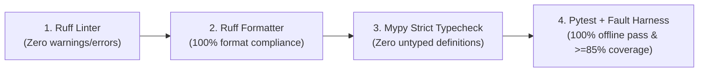

# Contributing to `stellar-paygate-py`

Thank you for your interest in contributing to **`stellar-paygate-py`**!

`stellar-paygate-py` is a native Python HTTP 402 pay-per-request payment gate, autonomous agent spend-policy client, and deterministic offline fault-injection harness for Soroban SEP-41 tokens on the Stellar network. It is designed as a **Modular Monolith** adhering to **Hexagonal Architecture (Ports and Adapters)** across six focused modules inside `src/stellar_paygate/`:

* `types.py`: Wire DTOs (`PAYMENT-REQUIRED`, `PAYMENT-SIGNATURE`, `PAYMENT-RESPONSE`), network profiles, and the canonical machine-readable error taxonomy.
* `codec.py`: Pure XDR builders, parsers, Ed25519 verifiers, and simulation event scanners for `G-accounts`, `C-accounts` (smart accounts), and `M-accounts` (CAP-67 muxed addresses).
* `exact.py`: Core verification and idempotent settlement engine for both fixed-price (`exact`) and metered-ceiling (`upto`) flows.
* `client.py`: Exact-integer `SpendPolicyGuard`, in-flight retry idempotency store, and `httpx` auto-payment transport.
* `fastapi_ext.py`: FastAPI and Starlette ASGI paywall middleware and route-level dependencies.
* `fault_harness.py`: Offline deterministic `FaultInjectingSorobanRpc` simulator and CLI conformance runner.

---

## 1. Getting Started

### Prerequisites

* **Python**: Version `3.11` or newer (`3.11`, `3.12`, `3.13`, `3.14` supported).
* **`uv`**: Fast Python package and virtual environment manager.
* **Git**: For version control and pull requests.

### Local Environment Workflow

1. Clone the `stellar-paygate-py` repository and navigate to the project root.
2. Synchronize the virtual environment and all development extras (`pytest`, `pytest-asyncio`, `pytest-cov`, `ruff`, `mypy`) using `uv sync --all-extras`.
3. Run the offline conformance suite and unit tests locally without needing any live Soroban RPC node, Friendbot funding, or secret keys.

---

## 2. Selecting and Claiming Tasks (Stellar Drips Wave)

1. **Review the Architecture & Protocol Docs First**:
   * Read [`docs/architecture.md`](docs/architecture.md) to understand the Hexagonal module boundaries and the **Strict Inward Dependency Rule**.
   * Read [`docs/protocol-and-edge-cases.md`](docs/protocol-and-edge-cases.md) and [`docs/fault-injection.md`](docs/fault-injection.md) to understand the Stellar XDR invariants and deterministic fault scenarios.
2. **Browse Scoped Issues**:
   * Check the issue catalog in [`docs/OPEN_SOURCE_CONTRIBUTION_PLAN.md`](docs/OPEN_SOURCE_CONTRIBUTION_PLAN.md) and the repository's GitHub Issues tab.
   * Tasks are categorized into three Drips Wave complexity tiers:
     * **Trivial (100 Points)**: Self-contained helpers, fallback decoders, formatting utilities, and targeted unit tests.
     * **Medium (150 Points)**: Multi-signer XDR verification, fee-bump envelope support, SQLite persistence adapters, and CI report exporters.
     * **High (200 Points)**: Streaming ASGI token metering, async pending-settlement outbox state machines, and discovery price-drift analyzers.
3. **Claiming an Issue**:
   * Comment on the target GitHub issue (and apply via the Drips Wave portal during active Wave cycles) and wait for maintainer assignment before opening a Pull Request.

---

## 3. Branching & Development Workflow

1. Synchronize your local `main` branch with upstream.
2. Create a dedicated feature or bugfix branch using the convention:
   * `feature/issue-<number>-<short-slug>` (for enhancements)
   * `fix/issue-<number>-<short-slug>` (for bug fixes)
   * `docs/issue-<number>-<short-slug>` (for documentation and diagrams)
3. Keep each Pull Request strictly scoped to its assigned issue. Do not bundle unrelated formatting sweeps or cross-module refactorings.

---

## 4. Mandatory Quality Standards & Verification Gates

Every Pull Request must pass four automated verification gates before review and merge:

| Gate | Tool | Requirement |
| :--- | :--- | :--- |
| **1. Linting** | `ruff check` | Zero lint errors across `src/` and `tests/` (`E`, `F`, `I`, `B`, `UP`, `SIM` rule sets). |
| **2. Formatting** | `ruff format --check` | 100-character line length and consistent import sorting. |
| **3. Static Typing** | `mypy --strict` | Complete type annotations on all functions, methods, DTOs, and test fixtures (`pydantic.mypy` plugin enabled). |
| **4. Offline Tests & Fault Conformance** | `pytest` & `fault_harness` | All unit tests, FastAPI/`httpx` ASGI tests, and deterministic fault-injection scenarios must pass offline in `< 5 seconds` with zero live network calls. |

---

## 5. Pull Request Expectations

* **Target Branch**: Open all Pull Requests against `main`.
* **Issue Linkage**: Include `Closes #<issue-number>` in the PR description.
* **Verification Evidence**: Paste the terminal summary output of `ruff`, `mypy`, and `pytest` in your PR body.
* **Offline Determinism**: Never write tests that depend on live internet access, `soroban-testnet.stellar.org`, or external faucets in the default test suite. Use `FaultInjectingSorobanRpc` from `fault_harness.py` for all automated CI tests.

---

## 6. Security & Non-Custodial Coding Rules

* **Zero Hardcoded Secrets**: Never commit real Stellar secret seeds (`S...`), private keys, or API tokens to source files, test fixtures, or documentation. Use ephemeral keypairs generated in memory during tests.
* **Exact Integer Arithmetic Only**: Never use IEEE-754 floating-point numbers (`float`) to parse, compare, or calculate token amounts or stroop fees. All token amounts must be handled as arbitrary-precision Python integers (`int`) in atomic units or quantized `decimal.Decimal` values.
* **Strict XDR Structural Validation**: Never trust unverified fields in an outer JSON payload (`payer`, `amount`, `signatureExpirationLedger`) without cross-checking them byte-for-byte against the decoded `SorobanAuthorizationEntry` or `TransactionEnvelope` XDR.
* **Anti-Drain Event Scanning**: When scanning simulated contract events, always verify that no unexpected secondary SEP-41 `transfer` events occurred alongside the authorized payment.

---

## 7. Additional References

* [`docs/architecture.md`](docs/architecture.md) — Hexagonal architecture and module responsibility matrix.
* [`docs/protocol-and-edge-cases.md`](docs/protocol-and-edge-cases.md) — Protocol flows, fee sponsorship, and edge-case specifications.
* [`docs/fault-injection.md`](docs/fault-injection.md) — Deterministic offline fault simulator and testing pyramid.
* [`docs/OPEN_SOURCE_CONTRIBUTION_PLAN.md`](docs/OPEN_SOURCE_CONTRIBUTION_PLAN.md) — Phased roadmap and Drips Wave issue catalog.
