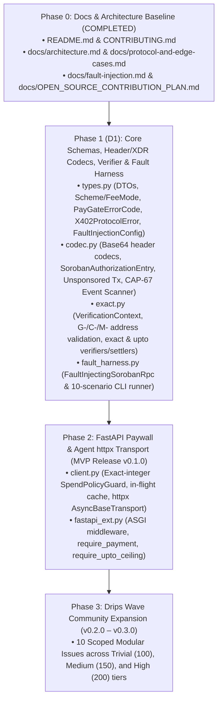

# Open-Source Contribution Plan, Roadmap & Drips Wave Backlog — `stellar-paygate-py`

**Project:** `stellar-paygate-py`  
**Document:** `docs/OPEN_SOURCE_CONTRIBUTION_PLAN.md`  
**Architecture Style:** Modular Monolith (Hexagonal / Ports & Adapters — 6 Core Modules in `src/stellar_paygate/`)  
**Community Program Alignment:** Stellar Wave Program on Drips Network  
**Repository Policy:** Public, Apache-2.0 Licensed, Continuous Integration Gated (`ruff`, `mypy --strict`, `pytest`)  
**Status:** Approved Specification Baseline  

---

## 1. Drips Wave Program Alignment & Phased Roadmap

The **Stellar Wave Program on Drips** brings external developers into high-impact Stellar open-source repositories during monthly contribution cycles. `stellar-paygate-py` is architected so contributors can claim, implement, and verify well-bounded tasks **100% offline** without needing funded Testnet wallets or external service credentials.

### Complexity Tiers
* **Trivial (100 Points)**: Self-contained helpers, alternative XDR event topic decoders, multi-RPC height quorum wrappers, and Decimal budget formatting utilities (`Issues #1–#3`).
* **Medium (150 Points)**: Multi-signer CAP-71 credential verification, `FeeBumpTransactionEnvelope` unsponsored transaction support, SQLite idempotency persistence, and SARIF/JUnit CI report formatters (`Issues #4–#7`).
* **High (200 Points)**: Discovery pricing (`typical` vs. ceiling) drift detectors, async pending-settlement outbox state machines with exponential backoff & DLQ, and FastAPI Server-Sent Events (SSE) streaming LLM token meters (`Issues #8–#10`).

---

## 2. Contributor Workflow & Verification Standards

1. **Read the Architecture & Protocol Specs**: Review [`docs/architecture.md`](architecture.md), [`docs/protocol-and-edge-cases.md`](protocol-and-edge-cases.md), and [`docs/fault-injection.md`](fault-injection.md) before writing code.
2. **Select & Claim an Issue (Wait for Assignment)**: Pick an unassigned issue from Section 3 (or the GitHub Issues tab), comment on the issue or apply via the Drips Wave portal, and **wait for explicit maintainer assignment** before submitting a Pull Request.
3. **Branch & Implement**: Create a focused branch (`feature/issue-<number>-<slug>`) off `main` touching only the target module(s) specified in the issue scope.
4. **Run Mandatory Offline Quality Gates**:
   * `uv run ruff check .` (zero lint warnings or errors)
   * `uv run ruff format --check .` (100% formatting compliance)
   * `uv run mypy src tests` (`--strict` static typing compliance)
   * `uv run pytest -v` (100% passing offline unit and fault-injection tests)
   * `uv run stellar-paygate-sim` (10/10 deterministic conformance scenarios passing)
5. **Submit Pull Request**: Open a PR against `main`, link the issue in the description (`Closes #<issue-number>`), and paste the output of the quality gates.

---

## 3. Scoped Drips Wave Issue Backlog (10 Modular Issues)

### Tier 1: Trivial Complexity (100 Points Each)

#### Issue 1 (100 pts): `[codec] Add CAP-67 4-topic muxed address fallback in simulation event scanner`
* **Target Files**: `src/stellar_paygate/codec.py`, `tests/test_codec_and_types.py`
* **Problem**: While modern CAP-67 SEP-41 token contracts emit `to_muxed_id` inside an `SCV_MAP` event data payload (`{amount: i128, to_muxed_id: u64}`), certain token implementations emit the 64-bit muxed ID as a 4th event topic (`topics[3] = SCV_U64`) while keeping `data = SCV_I128(amount)`.
* **Scope & Deliverables**:
  1. Update the event data/topic extractor in `codec.py` to inspect `v0.topics[3]` for an `SCV_U64` muxed ID when `v0.data` is a plain `SCV_I128`.
  2. Add unit tests in `tests/test_codec_and_types.py` covering both CAP-67 map data and 4-topic muxed event encoding, plus rejection when the 4-topic muxed ID mismatches `expected_pay_to`.
* **Acceptance Criteria**: Passes `ruff check`, `mypy --strict`, and `pytest` offline with 100% branch coverage on the new fallback.

#### Issue 2 (100 pts): `[fault_harness] Add QuorumSorobanRpcAdapter to eliminate negative ledger skew across RPC pools`
* **Target Files**: `src/stellar_paygate/fault_harness.py`, `tests/test_exact_and_faults.py`
* **Problem**: When a facilitator queries a load-balanced RPC pool, a single lagging node can report a ledger sequence 3–4 ledgers behind the network head. Querying `max(ledger_sequence)` across 2 or more RPC readers eliminates negative facilitator lag.
* **Scope & Deliverables**:
  1. Implement `QuorumSorobanRpcAdapter` implementing `SorobanRpcPort` over a list of inner `SorobanRpcPort` instances, returning the maximum observed ledger height and failing over cleanly if one reader raises a timeout.
  2. Add deterministic unit tests in `tests/test_exact_and_faults.py` with three simulated RPC readers at heights `[4_999_996, 5_000_000, 4_999_998]` proving zero false `invalid_exact_stellar_signature_expiration_too_far` rejections even under strict 2-ledger tolerance.
* **Acceptance Criteria**: Passes all offline tests and strict type checks.

#### Issue 3 (100 pts): `[client] Add human-readable Decimal budget formatting and reservation rollback to SpendPolicyGuard`
* **Target Files**: `src/stellar_paygate/client.py`, `tests/test_fastapi_httpx_e2e.py`
* **Problem**: Agent operators inspecting `SpendPolicyGuard` state need a clean helper to format atomic integer amounts back into quantized 7-decimal strings (`atomic_units_to_decimal`), inspect `remaining_budget_atomic`, and roll back a budget reservation if an HTTP retry fails with a local transport error before reaching the server.
* **Scope & Deliverables**:
  1. Add `atomic_units_to_decimal()`, `remaining_budget_atomic` property, and `release_reservation()` to `SpendPolicyGuard` in `client.py`.
  2. Automatically release the reserved amount in `client.py` if the inner `httpx` transport raises an `httpx.TransportError` on retry.
  3. Add unit tests verifying budget restoration on transport errors.
* **Acceptance Criteria**: Passes `ruff`, `mypy --strict`, and `pytest`.

---

### Tier 2: Medium Complexity (150 Points Each)

#### Issue 4 (150 pts): `[codec] Support multi-signer weighted threshold vectors in SorobanAuthorizationEntry verification`
* **Target Files**: `src/stellar_paygate/codec.py`, `tests/test_codec_and_types.py`
* **Problem**: Multi-sig accounts and delegated smart accounts authorize Soroban invocations using an `SCV_VEC` containing multiple `AccountEd25519Signature` maps sorted strictly by ascending 32-byte public key order.
* **Scope & Deliverables**:
  1. Extend Ed25519 signature vector verification in `codec.py` to support $N \ge 1$ signatures in `SCV_VEC`, enforcing strict ascending public-key byte order, rejecting duplicate public keys, and verifying every signature against the authorization preimage hash.
  2. Add unit tests for 2-of-2 multi-sig authorization entries, duplicate signer rejection, and unsorted signer key rejection.
* **Acceptance Criteria**: All multi-sig positive and negative test cases pass offline.

#### Issue 5 (150 pts): `[codec] Support FeeBumpTransactionEnvelope in unsponsored (areFeesSponsored: false) payment verification`
* **Target Files**: `src/stellar_paygate/codec.py`, `tests/test_exact_and_faults.py`
* **Problem**: Some Stellar wallets wrap client-paid transactions inside a `FeeBumpTransactionEnvelope` (`ENVELOPE_TYPE_TX_FEE_BUMP`) when broadcasting unsponsored payments.
* **Scope & Deliverables**:
  1. Update unsponsored transaction verification in `codec.py` to accept both `TransactionEnvelope` and `FeeBumpTransactionEnvelope`, extracting the inner transaction for SEP-41 `transfer(from, to, amount)` and `timeBounds` validation while verifying both the inner source signature and outer fee-source signature.
  2. Add unit tests for valid fee-bumped unsponsored transactions and tampered outer signature rejection.
* **Acceptance Criteria**: Passes `ruff`, `mypy --strict`, and `pytest`.

#### Issue 6 (150 pts): `[client] Add SQLite-backed persistent idempotency and receipt audit store`
* **Target Files**: `src/stellar_paygate/client.py`, `tests/test_fastapi_httpx_e2e.py`
* **Problem**: An in-memory in-flight payload cache is lost if an autonomous agent process restarts mid-request, risking a duplicate payment on restart.
* **Scope & Deliverables**:
  1. Implement `SqliteIdempotencyStore` using Python's standard library `sqlite3` to persist `(idempotency_key, payment_payload_json, signature_expiration_ledger, settled_tx_hash)` across restarts.
  2. Wire optional persistent storage into `SpendPolicyGuard` in `client.py` with automatic pruning of expired ledger rows.
  3. Add unit tests using a temporary SQLite file verifying cross-restart payload reuse.
* **Acceptance Criteria**: Zero external database dependencies required (uses stdlib `sqlite3`); passes all tests.

#### Issue 7 (150 pts): `[fault_harness] Add SARIF v2.1.0 and JUnit XML exporters to the conformance CLI runner`
* **Target Files**: `src/stellar_paygate/fault_harness.py`, `tests/test_exact_and_faults.py`
* **Problem**: CI/CD pipelines running `stellar-paygate-sim` need `--format sarif` (for GitHub Code Scanning) and `--format junit` (for CI test summary widgets) in addition to `--format markdown` and `--format json`.
* **Scope & Deliverables**:
  1. Add `--format {markdown,json,sarif,junit}` to the CLI entry point in `fault_harness.py`.
  2. Add schema validation tests in `tests/test_exact_and_faults.py` asserting valid SARIF v2.1.0 JSON structure and JUnit XML elements.
* **Acceptance Criteria**: CLI exits with `0` and produces valid SARIF and JUnit output for all 10 scenarios.

---

### Tier 3: High Complexity (200 Points Each)

#### Issue 8 (200 pts): `[exact & client] Implement discovery pricing metadata (typical vs. ceiling) validator and settlement drift tracker`
* **Target Files**: `src/stellar_paygate/types.py`, `src/stellar_paygate/client.py`, `src/stellar_paygate/exact.py`
* **Problem**: For `upto` metered endpoints, `PaymentRequirements.amount` is the maximum authorization *ceiling*, which is much higher than the typical cost of a call. Discovery catalogs attach `extensions.bazaar.pricing` (`model`, `unit`, `typical`, `note`) so agents can filter by typical price while verifying over time whether a seller's actual settled amounts match their declared `typical` price.
* **Scope & Deliverables**:
  1. Add `DiscoveryPricingExtension` DTO to `types.py`.
  2. Enhance `SpendPolicyGuard` in `client.py` to enforce separate thresholds for `max_typical_call_atomic` and `max_upto_ceiling_atomic`.
  3. Implement `SettlementDriftTracker` in `exact.py` that records observed `settled_amount` values per resource URL and flags endpoints whose rolling median settlement exceeds their declared `typical` price by $> 50\%$.
* **Acceptance Criteria**: Comprehensive unit tests covering pricing metadata validation, dual-threshold policy checks, and median drift detection.

#### Issue 9 (200 pts): `[exact] Implement async pending-settlement outbox state machine with exponential backoff and dead-letter queue (DLQ)`
* **Target Files**: `src/stellar_paygate/exact.py`, `src/stellar_paygate/fault_harness.py`, `tests/test_exact_and_faults.py`
* **Problem**: On live Soroban RPC nodes, `sendTransaction` returns `PENDING` and requires polling `getTransaction` across several ledgers, or retrying on transient RPC 503 responses while coalescing concurrent `/settle` requests for the same signed payload.
* **Scope & Deliverables**:
  1. Implement an async `SettlementOutboxManager` in `exact.py` managing deterministic state transitions (`VERIFIED -> SUBMITTED -> PENDING -> SETTLED | DLQ`) with per-fingerprint async locks.
  2. Extend `FaultInjectingSorobanRpc` in `fault_harness.py` to simulate multi-poll `PENDING -> PENDING -> SUCCESS` transitions and transient RPC 503 errors.
  3. Add concurrency tests firing 20 parallel settlement requests for the same payload and verifying that exactly 1 RPC submission occurs.
* **Acceptance Criteria**: Passes `pytest-asyncio` concurrency and DLQ transition tests offline.

#### Issue 10 (200 pts): `[fastapi_ext] Build Server-Sent Events (SSE) streaming LLM token meter with automatic ceiling cutoff and receipt frame`
* **Target Files**: `src/stellar_paygate/fastapi_ext.py`, `tests/test_fastapi_httpx_e2e.py`
* **Problem**: Streaming AI inference routes (`text/event-stream`) emit tokens incrementally and only know the final token count when the stream finishes—or when the client disconnects mid-stream or hits its authorized `upto` ceiling.
* **Scope & Deliverables**:
  1. Implement `PayGateStreamingUptoResponse` (subclassing Starlette's `StreamingResponse`) in `fastapi_ext.py` that wraps an async token chunk generator, meters accumulated atomic cost per chunk, halts generation cleanly if the running cost reaches the client's signed `upto` ceiling, settles the exact delivered cost via `MeteredSettlementContext.settle_usage()`, and appends a terminal `event: paygate-receipt` SSE frame containing the `SettleResponse` JSON.
  2. Add end-to-end `httpx` streaming tests covering normal completion below ceiling, mid-stream client disconnect (settling partial tokens delivered), and ceiling cutoff.
* **Acceptance Criteria**: All three streaming lifecycle scenarios pass offline with `httpx.ASGITransport`.
