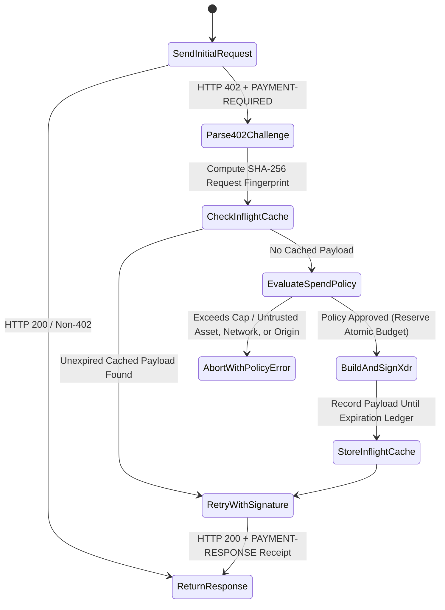

# Technical Design Document — `stellar-paygate-py`

**Project:** `stellar-paygate-py`  
**Document:** `docs/TECHNICAL_DESIGN.md`  
**Architecture Style:** Modular Monolith (Ports & Adapters / Hexagonal)  
**Language & Stack:** Python 3.11+ (`stellar-sdk`, `pydantic` v2, `httpx`, `fastapi` / `starlette`)  
**Architecture Record:** [`docs/ARCHITECTURE_DECISION.md`](ARCHITECTURE_DECISION.md) & [`docs/architecture.md`](architecture.md)  

---

## 1. Package Layout & Module Specifications

```text
stellar-paygate-py/
├── pyproject.toml
├── README.md
├── CONTRIBUTING.md
├── LICENSE
├── docs/
│   ├── ARCHITECTURE_DECISION.md
│   ├── BUILD_PLAN_5_DAYS.md
│   ├── IMPLEMENTATION_ROADMAP.md
│   ├── MVP_SCOPE.md
│   ├── MVP_VALIDATION_CHECKLIST.md
│   ├── OPEN_SOURCE_CONTRIBUTION_PLAN.md
│   ├── PRD.md
│   ├── RESEARCH_AND_REFERENCES.md
│   ├── SECURITY.md
│   ├── TECHNICAL_DESIGN.md
│   ├── TESTING_STRATEGY.md
│   ├── architecture.md
│   ├── fault-injection.md
│   └── protocol-and-edge-cases.md
├── src/
│   └── stellar_paygate/
│       ├── __init__.py
│       ├── types.py
│       ├── codec.py
│       ├── exact.py
│       ├── client.py
│       ├── fastapi_ext.py
│       └── fault_harness.py
└── tests/
    ├── test_codec_and_types.py
    └── test_exact_and_faults.py
```

---

## 2. Core Protocol & XDR Mechanics (`codec.py`)

### 2.1 `SorobanAuthorizationEntry` Preimage & Ed25519 Verification
For sponsored payments (`areFeesSponsored: true`), the client signs an `ENVELOPE_TYPE_SOROBAN_AUTHORIZATION` preimage consisting of:
1. **`network_id`**: 32-byte SHA-256 digest of the Stellar network passphrase (`Test SDF Network ; September 2015` for `stellar:testnet` or `Public Global Stellar Network ; September 2015` for `stellar:pubnet`).
2. **`nonce`**: 64-bit signed integer (`Int64`) uniquely identifying the authorization.
3. **`signature_expiration_ledger`**: 32-bit unsigned ledger sequence (`Uint32`) after which the authorization expires on-chain.
4. **`invocation`**: The `SorobanAuthorizedInvocation` tree:
   * For `exact`: Root contract function `transfer(from, to, amount)` on the SEP-41 asset contract with `sub_invocations = []`.
   * For `upto`: Root contract function `settle_upto(token, from, to, max_amount, valid_after_ledger, expiration_ledger, nonce)` on the `upto` settlement contract.

### 2.2 Multi-Event Simulation Scanner (`scan_simulation_events_for_transfer`)
When `simulateTransaction` executes a payment, `codec.py` decodes each base64 `DiagnosticEvent` XDR entry:
* Ignores events where `in_successful_contract_call == False` or `event.type != CONTRACT`.
* Inspects the first topic symbol (`v0.topics[0]`):
  * **Non-`transfer` symbol**: If emitted by a smart-account or policy contract (e.g., `spending_limit_checked`), appends `"<contract_id>:<topic>"` to `policy_events_observed` and continues scanning.
  * **`transfer` symbol**: Verifies that `contract_id == expected_asset_contract`, `topics[1] == expected_payer`, and `topics[2] == expected_base_recipient`.
  * **CAP-67 Muxed Data Extraction**: Extracts `(amount, to_muxed_id)` from either a plain `SCV_I128` data value or a CAP-67 `SCV_MAP` (`{"amount": SCV_I128, "to_muxed_id": SCV_U64}`). If `expected_pay_to` is an `M...` address, asserts `to_muxed_id == expected_muxed_id`.
  * **Anti-Drain Invariant**: If more than one `transfer` event is present, or if any `transfer` event does not match the authorized asset, sender, recipient, or amount/ceiling, immediately raises `invalid_exact_stellar_payload_unexpected_token_transfer`.

---

## 3. Verification & Settlement Engine (`exact.py`)

### 3.1 Ledger-Skew Window Formula
Given `facilitator_ledger` from `SorobanRpcPort.get_facilitator_latest_ledger()`:
$$\text{max\_ledger\_offset} = \lceil \text{maxTimeoutSeconds} / 5 \rceil$$
$$\text{max\_allowed\_ledger} = \text{facilitator\_ledger} + \text{max\_ledger\_offset} + \text{skew\_tolerance\_ledgers}$$
* If `signature_expiration_ledger <= facilitator_ledger`, reject with `invalid_exact_stellar_signature_expired`.
* If `signature_expiration_ledger > max_allowed_ledger`, reject with `invalid_exact_stellar_signature_expiration_too_far`.

### 3.2 Account-Aware Fee Ceiling & Refundable Rent Safety Margin
1. **Fee Ceiling Selection**:
   * Classic `G-account` payer: `max_transaction_fee_stroops` (default `50,000` stroops).
   * Smart-account `C-address` payer: `max_smart_account_fee_stroops` (default `250,000` stroops).
2. **Refundable Rent Safety Padding**:
   $$\text{padded\_resource\_fee} = \min\left(\text{fee\_ceiling} - \text{base\_fee},\ \left\lceil \text{simulated\_min\_resource\_fee} \times \left(1 + \frac{\text{margin\_bps}}{10000}\right) \right\rceil\right)$$
   With the default `margin_bps = 1500` (`+15%`), a `40,000`-stroop simulated resource fee is padded to `46,000` stroops before transaction submission, preventing `InsufficientRefundableFee` when persistent TTL extensions advance by 1–2 ledgers.

---

## 4. Client Policy Guard & `httpx` Transport (`client.py`)


