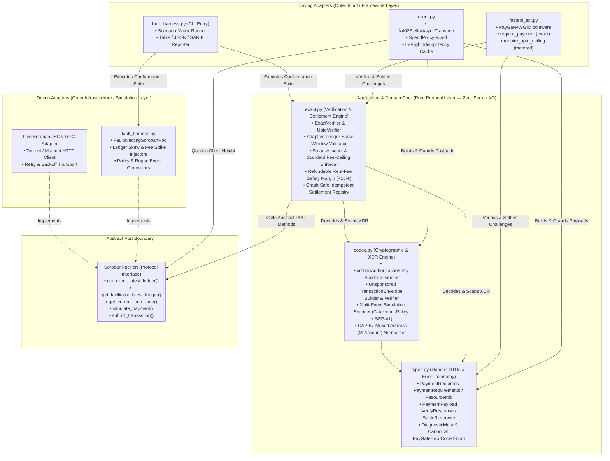
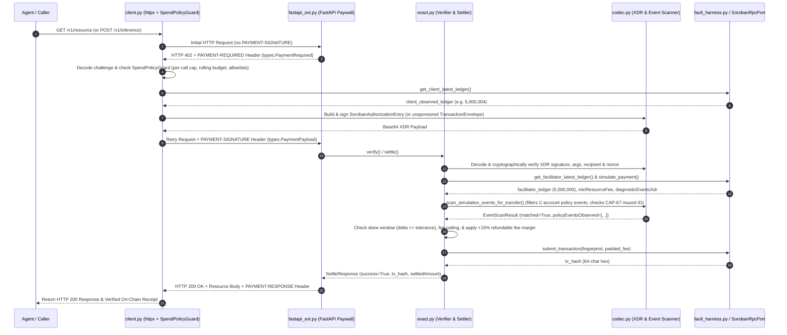

# System Architecture & Module Design Record — `stellar-paygate-py`

**Project:** `stellar-paygate-py`  
**Document:** `docs/architecture.md`  
**Architecture Style:** Modular Monolith with Ports & Adapters (Hexagonal Architecture)  
**Target Runtime:** Python 3.11+ (`stellar-sdk`, `pydantic` v2, `httpx`, `fastapi` / `starlette`)  
**Status:** Approved Specification Baseline  

---

## 1. Context & Architectural Goals

`stellar-paygate-py` enables Python web services (`FastAPI`, `Starlette`, ASGI apps) and autonomous AI agents (`httpx` clients, MCP tool runners) to negotiate, verify, and settle **HTTP `402 Payment Required`** transactions on the Stellar network using Soroban SEP-41 tokens (such as USDC).

Before writing any application code, we establish a strict architectural blueprint that satisfies four engineering goals:

1. **Zero-Baggage Single-Package Distribution**: API developers and agent authors must be able to install a single Python package (`stellar-paygate`) that works out-of-the-box without requiring external sidecar proxies, message brokers, or mandatory external facilitator microservices.
2. **Strict Separation of Protocol Math/XDR from Network I/O**: Cryptographic XDR serialization (`SorobanAuthorizationEntry`, `TransactionEnvelope`, `DiagnosticEvent`), signature verification, expiration math, and spend-policy checks must execute as pure, deterministic functions with zero direct HTTP or RPC socket coupling.
3. **First-Class Offline Fault Injection**: Every protocol edge case (load-balanced Soroban RPC ledger skew, smart-account `__check_auth` policy events, stroop fee spikes, CAP-67 muxed recipient IDs, refundable rent-fee drift, and duplicate settlement retries) must be 100% reproducible offline via an in-memory `SorobanRpcPort` adapter (`fault_harness.py`).
4. **High Modularity for Drips Wave Contributors**: The package must divide cleanly into six single-responsibility modules (`types.py`, `codec.py`, `exact.py`, `client.py`, `fastapi_ext.py`, `fault_harness.py`) so multiple contributors can work concurrently without merge collisions.

---

## 2. Evaluation of Architectural Candidates

 mirroring the architectural discipline of `soroban-sentinel`, we evaluated three structural patterns before locking in the design:

```text
+---------------------------------------------------------------------------------------------------+
|                                 ARCHITECTURAL PATTERN EVALUATION                                  |
+---------------------+------------------------------+-----------------------+----------------------+
| Criteria            | Candidate A: Distributed     | Candidate B: Framework| Candidate C: Modular |
|                     | Microservices (Gateway+DB+Q) | Coupled Monolith      | Monolith (Hexagonal) |
+---------------------+------------------------------+-----------------------+----------------------+
| Deployment Units    | 3+ Containers (Proxy Gateway,| Tightly coupled to    | Single Python pkg    |
|                     | Facilitator Svc, Redis/PG)   | FastAPI & live RPC    | + CLI fault runner   |
| Operational Overhead| Prohibitive for library/SDK  | Moderate: Hard to test| Minimal: Pure in-proc|
|                     | adopters & CI pipelines      | without live network  | library + optional CLI
| Domain Isolation    | High (Network IPC boundary)  | Poor: XDR & RPC calls | High: Pure core +    |
|                     |                              | mixed inside routes   | SorobanRpcPort trait |
| Offline Testability | Poor: Requires Docker Compose| Poor: Requires heavy  | Optimal: In-memory   |
|                     | & live Testnet accounts      | monkeypatching        | fault_harness.py     |
| Contributor Parallel| Fragmented across repos      | High merge-conflict   | Clean 6-module split |
| Velocity (Wave)     |                              | rate in one mega-file | with strict ports    |
| Verdict             | REJECTED                     | REJECTED              | ADOPTED              |
+---------------------+------------------------------+-----------------------+----------------------+
```

### Candidate A: Distributed Facilitator & Proxy Microservices (REJECTED)
* **Rationale for Rejection**: Forcing every Python API developer or AI agent researcher to deploy a multi-container stack (reverse proxy, standalone facilitator daemon, Redis queue, and PostgreSQL database) creates massive operational friction. While external HTTP facilitators can be supported via an adapter, the core verification, signing, and fault-simulation logic belongs in an embeddable library.

### Candidate B: Framework-Coupled Monolith (REJECTED)
* **Rationale for Rejection**: Embedding Soroban XDR parsing, `stellar-sdk` RPC network calls, and spend-budget checks directly inside FastAPI route handlers or `httpx` callbacks makes deterministic unit testing impossible without brittle mocking and prevents reuse across other ASGI frameworks or MCP servers.

### Candidate C: Modular Monolith with Ports and Adapters (ADOPTED)
* **Rationale for Adoption**:
  * **Pure Protocol Core (`types.py`, `codec.py`, `exact.py`)**: All wire validation, XDR decoding, Ed25519 verification, event scanning, and settlement state transitions depend only on an abstract `SorobanRpcPort` interface.
  * **Pluggable Driving Adapters (`client.py`, `fastapi_ext.py`)**: `httpx` and `FastAPI`/`Starlette` integrations are thin outer adapters that translate HTTP headers into domain DTOs and invoke the core engine.
  * **Deterministic Driven Adapter (`fault_harness.py`)**: Implements `SorobanRpcPort` entirely in memory, allowing CI pipelines and the CLI runner to inject arbitrary ledger skew, policy events, and fee spikes with zero network latency.

---

## 3. High-Level System & Component Architecture

### 3.1 Hexagonal Component Diagram



---

## 4. Module Map & Detailed Responsibilities

The package is organized into six primary modules inside `src/stellar_paygate/`:

```text
src/stellar_paygate/
├── __init__.py          # Public package exports and version metadata
├── types.py             # Pure domain DTOs, Base64 header codecs, network profiles, error codes
├── codec.py             # Pure Soroban XDR builders, Ed25519 verifiers, event & address codecs
├── exact.py             # Verification & settlement orchestrator (exact + upto + idempotency)
├── client.py            # SpendPolicyGuard, in-flight retry cache, and httpx AsyncBaseTransport
├── fastapi_ext.py       # FastAPI / Starlette ASGI paywall middleware & route dependencies
└── fault_harness.py     # Offline FaultInjectingSorobanRpc simulator & CLI conformance runner
```

### 4.1 `types.py` — Domain DTOs, Wire Schemas & Error Taxonomy
* **Purpose**: Defines the immutable data structures and wire representations shared across all layers.
* **Key Responsibilities**:
  * **HTTP Header Models**: `PaymentRequired` (`PAYMENT-REQUIRED`), `PaymentPayload` (`PAYMENT-SIGNATURE`), and `SettleResponse` (`PAYMENT-RESPONSE`) with deterministic Base64 JSON encoding and decoding (re-exported alongside `codec.py` helpers).
  * **Scheme & Fee Mode Enumerations**: `Scheme` (`exact`, `upto`) and `FeeMode` (`sponsored`, `unsponsored`).
  * **Requirement, Extra Config & Fault Config DTOs**: `PaymentRequirements`, `ResourceInfo`, `StellarExtraConfig` (`areFeesSponsored`, `uptoContract`, `uptoProfile`, `maxTransactionFeeStroops`), and `FaultInjectionConfig` (aliased as `FaultConfig`).
  * **Verification & Telemetry DTOs**: `VerifyResponse` and `DiagnosticMeta` (capturing `facilitatorLedger`, `clientObservedLedger`, `skewDeltaLedgers`, `simulatedMinResourceFeeStroops`, `paddedResourceFeeStroops`, `isSmartAccountPayer`, `policyEventsObserved`, and `muxedDestinationId`).
  * **Canonical Error Taxonomy**: `PayGateErrorCode` (aliased as `X402ErrorCode`) enumeration and `X402ProtocolError` (aliased as `PayGateVerificationError`) exception mapping every failure mode to a deterministic, machine-readable string code.
* **Allowed Dependencies**: Python standard library (`base64`, `json`, `enum`), `pydantic`.
* **Forbidden Dependencies**: `httpx`, `fastapi`, `starlette`, network sockets, or file I/O.

### 4.2 `codec.py` — Base64 Header Codecs, Pure XDR, Signature & Simulation Event Engine
* **Purpose**: Encapsulates Base64 JSON header encoding/decoding (`PAYMENT-REQUIRED`, `PAYMENT-SIGNATURE`, `PAYMENT-RESPONSE`) and all Stellar/Soroban binary XDR manipulation and cryptographic verification without performing any network calls.
* **Key Responsibilities**:
  * **Base64 JSON Wire Header Codecs**: `encode_payment_required_header` / `decode_payment_required_header`, `encode_payment_signature_header` / `decode_payment_signature_header`, and `encode_payment_response_header` / `decode_payment_response_header`.
  * **Soroban Authorization Preimage Hashing & Signing**: Constructs `ENVELOPE_TYPE_SOROBAN_AUTHORIZATION` preimages bound to the network passphrase SHA-256, `nonce`, `signature_expiration_ledger`, and `SorobanAuthorizedInvocation`, signing and verifying `AccountEd25519Signature` vectors for `G-accounts`.
  * **Smart-Account (`C-Address`) Credential Handling**: Builds and parses `SorobanAddressCredentials` where the authorizing address is a contract (`C...`), supporting both delegated Ed25519 signers and self-authorizing contract credentials.
  * **Unsponsored (`areFeesSponsored: false`) Transaction Codec**: Builds and structurally verifies complete `TransactionEnvelope` payloads signed by the payer's `G-account`, checking single-operation `InvokeHostFunctionOp` (`transfer`), `timeBounds.maxTime`, and outer Ed25519 transaction signatures.
  * **CAP-67 Muxed Address (`M-Address`) Normalization**: Extracts the underlying 32-byte `G-account` public key and 64-bit `muxed_id` from `M...` destination addresses.
  * **Multi-Event Simulation Scanner**: Decodes `DiagnosticEvent` XDR lists returned by Soroban simulation, safely recording non-transfer smart-account policy events while verifying the exact SEP-41 `transfer` event (including CAP-67 `to_muxed_id` maps) and rejecting any rogue secondary token transfer side-effects.
* **Allowed Dependencies**: `types.py`, `stellar-sdk` (XDR, Keypair, Address, MuxedAccount, TransactionBuilder, scval), Python `hashlib`.
* **Forbidden Dependencies**: `httpx`, `fastapi`, `starlette`, or live RPC network calls.

### 4.3 `exact.py` — Core Verification & Idempotent Settlement Engine
* **Purpose**: Orchestrates verification and settlement for both fixed-price (`exact`) and metered-ceiling (`upto`) payment flows against the abstract `SorobanRpcPort`.
* **Key Responsibilities**:
  * **Verification Context & Address Validation**: `VerificationContext` (aliased as `FacilitatorConfig`) and strict `G-`/`C-`/`M-` StrKey address format validation (`validate_stellar_address`, `classify_stellar_address`).
  * **Scheme & Network Validation**: Confirms protocol version (`2`), scheme matching (`exact` or `upto`), and network passphrase alignment (`stellar:testnet` or `stellar:pubnet`).
  * **Adaptive RPC Ledger-Skew Window Enforcement**: Compares the payload's `signature_expiration_ledger` against the facilitator's current ledger plus `max_timeout_seconds / 5s` and `skew_tolerance_ledgers` (default `5` ledgers instead of the brittle `2`-ledger legacy threshold), recording the observed `skew_delta_ledgers`.
  * **Smart-Account-Aware Fee Ceilings & Refundable Rent Padding**: Enforces `max_transaction_fee_stroops` (`50,000` default for `G-accounts`) vs. `max_smart_account_fee_stroops` (`250,000` default for `C-accounts`), and applies `refundable_fee_safety_margin_bps` (default `+15%` / `1500 bps`) before transaction submission to prevent `InsufficientRefundableFee` failures when TTL-extending calls advance by 1–2 ledgers.
  * **Metered `upto` Ceiling Verification & Post-Execution Settlement**: Verifies that `valid_after_ledger <= current_ledger < signature_expiration_ledger` and enforces `0 < actual_amount <= authorized_max_amount` at settlement time.
  * **Idempotent Settlement Outbox & Nonce Replay Guard**: Tracks settled payload SHA-256 fingerprints so duplicate `/settle` requests return the existing `transaction` hash with `idempotentReplay=True` (zero double-submissions), while rejecting any *different* payload that attempts to reuse a consumed `(payer, nonce)` pair.
* **Allowed Dependencies**: `types.py`, `codec.py`, abstract `SorobanRpcPort` protocol.
* **Forbidden Dependencies**: `fastapi`, `starlette`, `httpx` client transports.

### 4.4 `client.py` — Agent Spend-Policy Guard & `httpx` Auto-Pay Transport
* **Purpose**: Protects autonomous AI agents and Python applications from overspending, precision bugs, or double-paying during HTTP retries.
* **Key Responsibilities**:
  * **Exact-Integer `SpendPolicyGuard`**: Converts human decimal strings into exact integer atomic units using `decimal.Decimal` (eliminating IEEE-754 float precision loss above $2^{53}$) and enforces `max_per_call_atomic`, `max_rolling_budget_atomic`, `allowed_networks`, `allowed_assets`, and `allowed_origins`.
  * **In-Flight Idempotency Cache**: Hashes `(HTTP method, URL, Idempotency-Key, request body)` and caches signed `PaymentPayload` objects until `signature_expiration_ledger` so that retrying an HTTP 502/504 timeout reuses the same signed authorization entry rather than signing a new nonce and double-paying.
  * **`httpx` Async Transport Wrapper**: Intercepts HTTP `402` responses containing `PAYMENT-REQUIRED`, evaluates `SpendPolicyGuard`, builds and signs the appropriate `exact`, `upto`, or `unsponsored` payload, and retries the request with `PAYMENT-SIGNATURE`.
* **Allowed Dependencies**: `types.py`, `codec.py`, `exact.py`, `httpx`, `stellar-sdk` (`Keypair`), Python `decimal`.
* **Forbidden Dependencies**: `fastapi`, `starlette`.

### 4.5 `fastapi_ext.py` — ASGI Paywall Middleware & Metered Route Dependencies
* **Purpose**: Provides drop-in server-side monetization for FastAPI and Starlette applications.
* **Key Responsibilities**:
  * **ASGI Paywall Middleware**: Maps `(HTTP method, route path)` patterns to `PaymentRequirements`, automatically issuing HTTP `402` challenges with Base64 `PAYMENT-REQUIRED` headers when `PAYMENT-SIGNATURE` is absent or invalid, and attaching `PAYMENT-RESPONSE` receipts on `200 OK`.
  * **Fixed-Price Route Dependency (`require_payment`)**: FastAPI `Depends(...)` callable that verifies and settles an `exact` payment before entering the route handler and injects the `SettleResponse` receipt into the endpoint.
  * **Metered Route Dependency (`require_upto_ceiling`)**: FastAPI `Depends(...)` callable that pre-verifies an `upto` ceiling authorization before executing an expensive workload (such as LLM token generation) and injects a `MeteredSettlementContext` so the handler can call `settle_usage(actual_amount_atomic)` after computing actual usage.
* **Allowed Dependencies**: `types.py`, `exact.py`, `fastapi`, `starlette`.
* **Forbidden Dependencies**: `httpx` client transport.

### 4.6 `fault_harness.py` — Offline Deterministic Fault-Injecting RPC & Conformance CLI
* **Purpose**: Enables 100% offline, deterministic simulation of Stellar RPC behavior and protocol faults for unit tests, CI pipelines, and interactive conformance audits.
* **Key Responsibilities**:
  * **`FaultInjectingSorobanRpc`**: Implements `SorobanRpcPort` in memory with configurable fault knobs (`client_ledger_skew`, `simulated_min_resource_fee_stroops`, `required_submission_resource_fee_stroops`, `inject_smart_account_policy_events`, `inject_rogue_transfer_event`, `override_emitted_muxed_id`, `force_simulation_error`, and `current_unix_time`).
  * **10-Scenario Conformance Runner & CLI (`stellar-paygate-sim`)**: Runs the complete battery of positive and negative protocol scenarios and prints a human-readable Markdown table or machine-readable JSON report.
* **Allowed Dependencies**: `types.py`, `codec.py`, `exact.py`, Python `argparse`, `json`.

---

## 5. Module Responsibility & Dependency Matrix

| Module | Layer | Primary Responsibility | Allowed Internal Imports | External Libraries Allowed | Forbidden Dependencies |
| :--- | :--- | :--- | :--- | :--- | :--- |
| **`types.py`** | Domain Core | DTOs, Base64 header codecs, error codes, network constants | *(None — leaf module)* | `pydantic`, stdlib | `stellar-sdk`, `httpx`, `fastapi`, `starlette`, network I/O |
| **`codec.py`** | Domain Core | XDR auth-entry, unsponsored tx, CAP-67 muxed & event codecs | `types.py` | `stellar-sdk`, stdlib | `httpx`, `fastapi`, `starlette`, socket I/O |
| **`exact.py`** | Application Core | `exact` & `upto` verification, skew/fee rules, idempotent settlement | `types.py`, `codec.py` | `stellar-sdk`, stdlib | `httpx`, `fastapi`, `starlette` |
| **`client.py`** | Driving Adapter | `SpendPolicyGuard`, in-flight cache, `httpx` 402 transport | `types.py`, `codec.py`, `exact.py` | `httpx`, `stellar-sdk`, stdlib | `fastapi`, `starlette` |
| **`fastapi_ext.py`** | Driving Adapter | FastAPI/Starlette 402 middleware & `exact`/`upto` dependencies | `types.py`, `exact.py` | `fastapi`, `starlette`, stdlib | `httpx` client transport |
| **`fault_harness.py`** | Driven Adapter & CLI | Offline `FaultInjectingSorobanRpc` & conformance CLI runner | `types.py`, `codec.py`, `exact.py` | `stellar-sdk`, stdlib | `fastapi`, `starlette`, live network sockets |

> [!IMPORTANT]
> **The Strict Inward Dependency Rule**:
> Inner domain modules (`types.py`, `codec.py`, `exact.py`) **MUST NEVER** import from outer framework or transport adapters (`client.py`, `fastapi_ext.py`). All RPC interactions inside `exact.py` occur exclusively through the abstract `SorobanRpcPort` protocol interface, guaranteeing that the core engine can be tested completely offline via `fault_harness.py`.

---

## 6. End-to-End Data Flow Across the Six Modules


