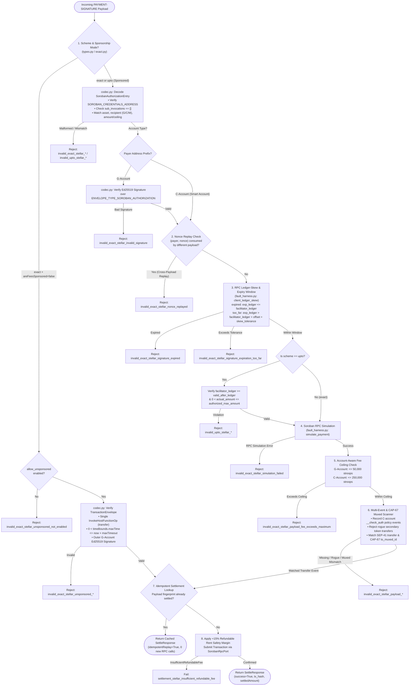

# Deterministic Fault-Injection, Testing Strategy & Security Model — `stellar-paygate-py`

**Project:** `stellar-paygate-py`  
**Document:** `docs/fault-injection.md`  
**Architecture Style:** Modular Monolith (Hexagonal / Ports & Adapters)  
**Primary Harness Module:** `src/stellar_paygate/fault_harness.py` (`FaultInjectingSorobanRpc`)  
**Status:** Approved Specification Baseline  

---

## 1. Testing Philosophy in Hexagonal Architecture

Adopting a Ports-and-Adapters (Hexagonal) architecture allows `stellar-paygate-py` to verify every cryptographic XDR invariant, fee rule, and distributed timing fault **100% offline in milliseconds** before ever touching a live Soroban Testnet endpoint:

```text
                  / \
                 /   \       Live Soroban Testnet Verification (Opt-In)
                / E2E \      (Real Soroban RPC, Funded Testnet USDC Accounts)
               /-------\
              /         \    In-Process ASGI & httpx Transport Tests (100% Offline)
             /  Adapters \   (FastAPI Paywall + httpx AsyncTransport + SpendPolicyGuard)
            /-------------\
           /               \ Deterministic Fault-Injection & XDR Unit Tests (100% Offline)
          /   Core & Fault  \(codec.py, exact.py, fault_harness.py — Zero Network Calls)
         /-------------------\
```

* **Layer 1 — Pure XDR & Fault-Harness Tests (`codec.py`, `exact.py`, `fault_harness.py`)**: Execute in `< 1 second` with zero network sockets. Tests binary XDR roundtrips, Ed25519 signature tampering, smart-account policy event filtering, CAP-67 muxed ID verification, RPC ledger skew, and refundable rent-fee drift.
* **Layer 2 — In-Process ASGI & Agent Transport Tests (`fastapi_ext.py`, `client.py`)**: Uses `httpx.ASGITransport` wired directly to a FastAPI application and `FaultInjectingSorobanRpc` in memory. Exercises the full HTTP `402` challenge -> `SpendPolicyGuard` -> XDR signing -> retry -> settlement -> `PAYMENT-RESPONSE` receipt cycle without opening a TCP port.
* **Layer 3 — CLI Conformance Suite (`stellar-paygate-sim`)**: Runs the 10 canonical protocol and fault scenarios end-to-end and outputs a pass/fail conformance table in Markdown or JSON.

---

## 2. Deterministic Fault-Injection & Edge-Case Decision Flow

The Mermaid flowchart below illustrates the exact verification and fault-injection decision pipeline executed by `exact.py`, `codec.py`, and `fault_harness.py` whenever a `PAYMENT-SIGNATURE` header arrives:



---

## 3. Canonical Fault-Injection Scenario Catalog (`fault_harness.py`)

`FaultInjectingSorobanRpc` exposes deterministic configuration knobs (`FaultInjectionConfig` / `FaultConfig`) that power the 10 built-in conformance scenarios in `stellar-paygate-sim`:

| Scenario ID | Fault / Edge-Case Injected | Configuration Knob in `FaultInjectionConfig` (`FaultConfig`) | Expected Verifier / Settler Outcome |
| :---: | :--- | :--- | :--- |
| **`S01`** | Baseline `G-account` fee-sponsored `exact` SEP-41 payment | Default (`client_ledger_skew=0`, `fee=38,000`) | `success=True`, `settledAmount="1000000"`, 64-char hex `transaction` hash. |
| **`S02`** | Load-balanced Soroban RPC `+4` ledger height skew between client and facilitator | `client_ledger_skew = 4` | Legacy `skew_tolerance_ledgers=2` rejects with `invalid_exact_stellar_signature_expiration_too_far`; default `skew_tolerance_ledgers=5` passes and records `skewDeltaLedgers=4`. |
| **`S03`** | Smart Account (`C-address`) emitting 2 `__check_auth` policy events + `95,000` stroop fee | `inject_smart_account_policy_events = [...]`, `simulated_min_resource_fee_stroops = 95_000` | `isValid=True`, `isSmartAccountPayer=True`, `policyEventsObserved` records both events without false rejection, and `250,000`-stroop smart-account fee ceiling permits settlement. |
| **`S04`** | Malicious secondary token `transfer` side-effect during simulation (anti-drain test) | `inject_rogue_transfer_event = (asset, payer, attacker, 5_000_000)` | Rejected immediately with `invalid_exact_stellar_payload_unexpected_token_transfer`. |
| **`S05`** | CAP-67 Muxed destination (`M-account`) transfer event verification & ID spoofing test | `payTo = "M..."`, then `override_emitted_muxed_id = 111111111` | Matching `to_muxed_id` passes (`muxedDestinationId=987654321`); mismatched `to_muxed_id` rejects with `invalid_exact_stellar_recipient_mismatch`. |
| **`S06`** | Unsponsored (`areFeesSponsored: false`) client-signed `TransactionEnvelope` verification | `extra.areFeesSponsored = False` | `codec.py` verifies single-op `InvokeHostFunctionOp`, `timeBounds.maxTime`, and outer `G-account` signature; settles with `success=True`. |
| **`S07`** | Refundable rent-fee drift between simulation (`40,000` stroops) and inclusion (`43,500` stroops) | `simulated_min_resource_fee_stroops = 40_000`, `required_submission_resource_fee_stroops = 43_500` | Unpadded (`margin_bps=0`) fails with `settlement_stellar_insufficient_refundable_fee`; default `+15%` padding (`margin_bps=1500` -> `46,000` stroops) settles with `success=True`. |
| **`S08`** | Duplicate `/settle` retry deduplication vs. cross-payload `(payer, nonce)` replay attack | Same payload settled twice; then same `nonce` signed on a new recipient payload | Duplicate `/settle` returns `idempotentReplay=True` with `submission_count == 1`; cross-payload nonce reuse is rejected with `invalid_exact_stellar_nonce_replayed`. |
| **`S09`** | Metered `upto` ceiling authorization (`0.10 USDC`) with partial post-execution settlement (`0.007 USDC`) | `scheme="upto"`, `amount="1000000"`, `actual_amount=70_000` | `success=True`, `settledAmount="70000"`. |
| **`S10`** | Metered `upto` over-ceiling settlement attempt (`actual_amount > authorized_max_amount`) | `scheme="upto"`, `amount="1000000"`, `actual_amount=1_500_000` | Rejected with `invalid_upto_stellar_exceeds_authorized_max`. |

---

## 4. Boundary & Failure Mode Test Matrix

| Category | Boundary / Adversarial Condition | Expected System Behavior | Target Module |
| :--- | :--- | :--- | :--- |
| **Precision** | Token amount above $2^{53}$ stroops or 7-decimal string `"0.51"` | Converted via `decimal.Decimal` into exact integer atomic units with zero IEEE-754 rounding error | `client.py` |
| **Precision** | Decimal string with $> 7$ fractional digits (e.g., `"0.12345678"`) | Raises explicit `ValueError` instead of silently truncating sub-stroop dust | `client.py` |
| **Policy Guard** | Challenge `amount` exceeds `max_per_call_atomic` | Aborts before signing; raises `policy_stellar_per_call_cap_exceeded` | `client.py` |
| **Policy Guard** | Cumulative spend across calls exceeds `max_rolling_budget_atomic` | Aborts before signing; raises `policy_stellar_rolling_budget_exceeded` | `client.py` |
| **Policy Guard** | Challenge advertises untrusted network, asset, or origin | Aborts before signing; raises `policy_stellar_{network,asset,origin}_not_allowed` | `client.py` |
| **XDR Tampering** | Payer signs `100,000` stroops in XDR but outer JSON claims `900,000` | Rejected with `invalid_exact_stellar_amount_mismatch` | `codec.py` |
| **XDR Tampering** | `SorobanAuthorizationEntry` includes hidden `sub_invocations` | Rejected with `invalid_exact_stellar_unexpected_sub_invocations` | `codec.py` |
| **TimeBounds** | Unsponsored transaction has `timeBounds.maxTime == 0` or already expired | Rejected with `invalid_exact_stellar_unsponsored_timebounds` | `codec.py` |
| **Upto Window** | Facilitator ledger is strictly less than signed `validAfterLedger` | Rejected with `invalid_upto_stellar_before_valid_after_ledger` | `exact.py` |
| **Upto Amount** | Route attempts to settle `0` or negative stroops on an `upto` payload | Rejected with `invalid_upto_stellar_non_positive_amount` | `exact.py` |

---

## 5. Security Architecture & Non-Custodial Threat Model

```text
+---------------------------------------------------------------------------------------------------+
|                           NON-CUSTODIAL SECURITY BOUNDARIES                                       |
|                                                                                                   |
|  1. Client-Side Signing Isolation (`client.py`):                                                  |
|     • Secret keys remain exclusively inside the caller's in-memory `Keypair` instance.            |
|     • `SpendPolicyGuard` executes BEFORE any XDR preimage is signed.                              |
|     • Only the public `SorobanAuthorizationEntry` (or signed `TransactionEnvelope`) crosses HTTP. |
|                                                                                                   |
|  2. Non-Custodial Facilitator / Verifier Boundary (`exact.py` + `codec.py`):                      |
|     • In sponsored mode, the client signs `transfer(from, to, amount)` directly to `payTo`.       |
|     • The facilitator only sponsors the XLM inclusion/resource fee and never takes custody of     |
|       the settlement token.                                                                       |
|                                                                                                   |
|  3. Simulation Event Verification (`codec.py`):                                                   |
|     • Never trusts declared arguments alone; verifies that `simulateTransaction` actually         |
|       emitted a matching SEP-41 `transfer` event from the exact token contract and emitted        |
|       zero unauthorized secondary token transfers.                                                |
+---------------------------------------------------------------------------------------------------+
```

---

## 6. Concrete MVP Acceptance Criteria (v0.1.0 Definition of Done)

| Criterion ID | Requirement | Verification Method |
| :---: | :--- | :--- |
| **AC-1** | All 6 modules (`types.py`, `codec.py`, `exact.py`, `client.py`, `fastapi_ext.py`, `fault_harness.py`) respect the Hexagonal Inward Dependency Rule | Architectural import inspection & `mypy --strict` |
| **AC-2** | `stellar-paygate-sim` executes all 10 deterministic conformance and fault-injection scenarios (`S01`–`S10`) offline and exits with code `0` | Automated CLI test (`--json` and Markdown table modes) |
| **AC-3** | FastAPI app with `PayGateASGIMiddleware`, `require_payment` (`exact`), and `require_upto_ceiling` (`upto`) completes full 402 -> sign -> 200 + receipt flows against `httpx` client | Offline ASGI + `httpx` E2E test suite |
| **AC-4** | `SpendPolicyGuard` uses exact integer/Decimal arithmetic and enforces per-call caps, rolling budgets, and network/asset/origin allowlists | Unit & boundary test suite |
| **AC-5** | Zero lint errors under `ruff check`, zero format diffs under `ruff format --check`, zero type errors under `mypy --strict`, and $\ge 85\%$ test coverage | GitHub Actions CI workflow |
