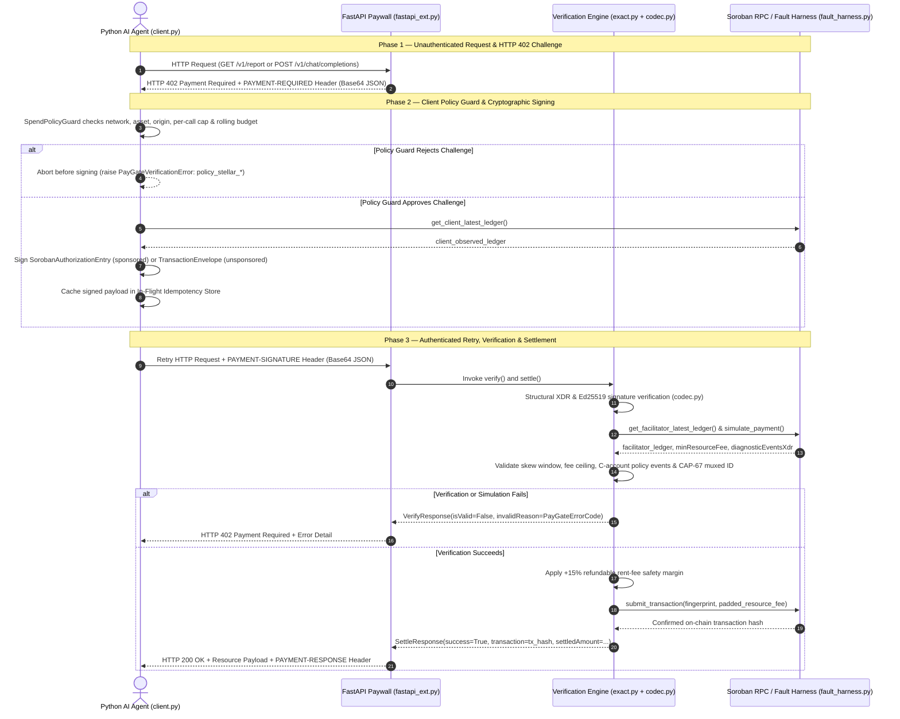

# Protocol Mechanics & Edge-Case Specification — `stellar-paygate-py`

**Project:** `stellar-paygate-py`  
**Document:** `docs/protocol-and-edge-cases.md`  
**Standards Covered:** HTTP `402 Payment Required` (x402 v2 wire format), Stellar SEP-41 Token Interface, CAP-0046-06 (Soroban Authorization), CAP-0067 (Muxed Address Events), CAP-0071 (Custom Account Credentials)  
**Status:** Approved Specification Baseline  

---

## 1. Payment Schemes: Fixed-Price `exact` vs. Metered `upto`

`stellar-paygate-py` supports two distinct payment schemes over the same three HTTP headers (`PAYMENT-REQUIRED`, `PAYMENT-SIGNATURE`, and `PAYMENT-RESPONSE`):

```text
+---------------------------------------------------------------------------------------------------+
|                             PAYMENT SCHEME COMPARISON ON STELLAR                                  |
+------------------------+------------------------------------+-------------------------------------+
| Dimension              | Scheme 1: `exact` (Fixed Price)    | Scheme 2: `upto` (Metered Ceiling)  |
+------------------------+------------------------------------+-------------------------------------+
| Target Workloads       | Fixed-cost API endpoints, data     | LLM token inference, compute-time   |
|                        | snapshots, single search queries,  | billing, per-byte streaming where   |
|                        | pay-per-article/report downloads.  | cost is unknown until execution ends|
| Meaning of `amount` in | Exact atomic token price charged   | Maximum atomic token ceiling the    |
| `PaymentRequirements`  | for the request.                   | client authorizes for the request.  |
| Signed Soroban Root    | SEP-41 token contract:             | Upto settlement contract:           |
| Invocation             | `transfer(from, to, amount)`       | `settle_upto(token, from, to, max,  |
|                        |                                    |  valid_after, exp_ledger, nonce)`   |
| When Settlement Occurs | Before the route handler runs      | Pre-verified before route runs;     |
|                        | (or immediately inside middleware).| settled post-execution at `actual`. |
| On-Chain Amount Moved  | `settled_amount == amount`         | `0 < actual_amount <= max_amount`   |
+------------------------+------------------------------------+-------------------------------------+
```

### 1.1 The `exact` Scheme Lifecycle
1. **Challenge Issuance**: The FastAPI resource server returns `HTTP 402` with a Base64-encoded `PAYMENT-REQUIRED` header listing `scheme: "exact"`, `network` (`stellar:testnet` or `stellar:pubnet`), `asset` (SEP-41 contract ID `C...`), `amount` (atomic integer string), `payTo` (`G...`, `C...`, or `M...`), and `maxTimeoutSeconds`.
2. **Authorization Signing**: In the default sponsored flow (`areFeesSponsored: true`), the client signs a `SorobanAuthorizationEntry` authorizing a single top-level call to `transfer(from, to, amount)` on the SEP-41 token contract with `sub_invocations = []`.
3. **Verification & Settlement**: The verifier decodes the XDR, confirms `sub_invocations` is empty, verifies the Ed25519 signature (or smart-account `__check_auth` simulation), verifies the simulated SEP-41 `transfer` event, submits the transaction on-chain, and returns the resource alongside a Base64-encoded `PAYMENT-RESPONSE` receipt carrying the transaction hash.

### 1.2 The `upto` Metered Ceiling Lifecycle
Why bare SEP-41 `approve` + `transfer_from` is insufficient for `upto`:
* **Missing Recipient Binding**: `approve(from, spender, max_amount, live_until_ledger)` does not bind the recipient `to` under the client's signature; a compromised facilitator could redirect funds to an arbitrary address at `transfer_from` time.
* **Missing Single-Use Enforcement**: A single allowance can be drawn down across multiple `transfer_from` calls up to `max_amount`, violating the single-settlement invariant of a per-request HTTP 402 authorization.

How `stellar-paygate-py` implements `upto`:
1. **Ceiling Binding**: The client signs a `SorobanAuthorizationEntry` targeting the `upto` settlement contract function `settle_upto(token, from, to, max_amount, valid_after_ledger, expiration_ledger, nonce)`. Every security boundary—asset, payer, recipient, maximum ceiling, validity window, and single-use nonce—is cryptographically bound under the client's signature.
2. **Pre-Execution Verification**: `require_upto_ceiling` in `fastapi_ext.py` verifies the signed ceiling authorization and simulates execution before running the expensive route handler.
3. **Post-Execution Actual Settlement**: Once the route handler finishes (e.g., generating 350 LLM tokens at 200 stroops/token = `70,000` stroops against a `1,000,000` stroop ceiling), the handler invokes `meter.settle_usage(70_000)`. The engine enforces `0 < actual_amount <= max_amount` (rejecting non-positive or over-ceiling amounts with `invalid_upto_stellar_non_positive_amount` or `invalid_upto_stellar_exceeds_authorized_max`) and settles the exact usage in a single transaction.

---

### 1.3 HTTP 402 Payment & Settlement Sequence Diagram



---

## 2. Fee Sponsorship Modes: `sponsored` vs. `unsponsored`

### 2.1 Fee-Sponsored Mode (`areFeesSponsored: true` — Default)
* **How It Works**: The client signs **only** the `SorobanAuthorizationEntry` (`authEntryXdr`), not a outer Stellar transaction. The facilitator/server wraps the client's signed authorization entry inside a transaction sourced, sequenced, and paid for in XLM by the facilitator's own account.
* **Key Benefits**:
  * **Zero XLM Required for Payers**: An AI agent wallet only needs to hold the settlement token (e.g., USDC) and does not need to maintain an XLM balance or manage Stellar account sequence numbers.
  * **Non-Custodial Security**: Because the client signs the exact `InvokeContractArgs` (`transfer(from, to, amount)`), the facilitator cannot alter the asset, amount, or recipient without invalidating the client's signature.

### 2.2 Unsponsored Mode (`areFeesSponsored: false` — Client-Paid Fees)
* **Upstream Gap Solved**: In existing TypeScript implementations, passing `areFeesSponsored: false` is accepted by configuration constructors without validation, advertising `areFeesSponsored: false` on `/supported` and then failing 100% of settlements because unsponsored transaction construction and verification were never implemented.
* **How `stellar-paygate-py` Implements Unsponsored Flows**:
  1. **Explicit Facilitator Policy Toggle (`allow_unsponsored`)**: If an operator sets `allow_unsponsored=False` while a route advertises `areFeesSponsored: false`, the verifier immediately rejects with `invalid_exact_stellar_unsponsored_not_enabled` rather than failing silently.
  2. **Client Full-Transaction Construction**: When `areFeesSponsored: false`, `client.py` and `codec.py` construct a complete `TransactionEnvelope` (`transactionXdr`) sourced and signed by the client's `G-account` with a valid sequence number, fee, and `timeBounds.maxTime <= current_unix_time + maxTimeoutSeconds`.
  3. **Strict Structural & Signature Verification**: `codec.py` decodes the `TransactionEnvelope` and verifies:
     * The envelope is a standard `TransactionEnvelope` with **exactly 1 operation** (`InvokeHostFunctionOp`).
     * `timeBounds.maxTime` is non-zero, has not expired (`maxTime > current_unix_time`), and does not exceed `current_unix_time + maxTimeoutSeconds + 15s`.
     * The inner `HostFunction` invokes `transfer(from, to, amount)` on the expected `asset` contract where `from == tx.source.account_id`, `to == expected_pay_to`, and `amount == expected_amount`.
     * The outer `TransactionEnvelope.signatures` list contains a valid Ed25519 signature from the client's source `G-account` over the transaction hash.
  4. **Direct Broadcast**: The facilitator broadcasts the client's verified `TransactionEnvelope` as-is without re-sourcing or re-signing.

---

## 3. Soroban RPC Clock & Ledger-Skew Tolerance

### 3.1 The Load-Balanced RPC Skew Problem
In a Soroban authorization flow, the client and the facilitator each sample the current ledger sequence independently via `getLatestLedger()`:
* The client computes `signature_expiration_ledger = client_ledger + ceil(maxTimeoutSeconds / 5)`.
* The facilitator computes `max_allowed_ledger = facilitator_ledger + ceil(maxTimeoutSeconds / 5) + tolerance`.
* Because `ceil(maxTimeoutSeconds / 5)` is identical on both sides, the rejection predicate reduces to:
  $$\text{Reject} \iff \text{client\_ledger} - \text{facilitator\_ledger} > \text{tolerance}$$

When querying load-balanced RPC pools (such as `https://soroban-testnet.stellar.org` or multi-region commercial RPC providers), consecutive calls routinely hit backing nodes whose heights differ by 3 to 4 ledgers. A hardcoded `tolerance = 2` rejects valid, freshly signed payments with `invalid_exact_stellar_signature_expiration_too_far`.

### 3.2 Adaptive Skew Tolerance & Telemetry in `stellar-paygate-py`
1. **Configurable `skew_tolerance_ledgers` (Default `5` Ledgers / ~25 Seconds)**: Absorbs normal load-balancer height divergence across RPC nodes while still bounding maximum authorization lifetime tightly.
2. **Client-Observed Ledger Propagation & Telemetry**: The client includes `clientObservedLedger` in the payment payload metadata, allowing the verifier to compute `skewDeltaLedgers = clientObservedLedger - facilitatorLedger` and return it inside `VerifyResponse.diagnosticMeta` for operator observability.

---

## 4. Address Architectures: `G-Accounts`, Smart Accounts (`C-`), & Muxed (`M-`)

```text
+---------------------------------------------------------------------------------------------------+
|                         STELLAR ADDRESS SUPPORT MATRIX IN stellar-paygate-py                      |
+-------------------+-----------------------+-------------------------------------------------------+
| Address Prefix    | Role in Payment Flow  | Protocol Mechanics & Edge-Case Handling               |
+-------------------+-----------------------+-------------------------------------------------------+
| `G...` (Ed25519   | Payer or Recipient    | • Standard `SorobanAddressCredentials` signed with    |
| Classic Account)  | (`payTo`)             |   `SCV_VEC([SCV_MAP({public_key, signature})])`.      |
|                   |                       | • Also supports unsponsored `TransactionEnvelope`.    |
+-------------------+-----------------------+-------------------------------------------------------+
| `C...` (Soroban   | Payer (Smart Account) | • Custom account `__check_auth` runs during simulation|
| Contract Address) | or Recipient (`payTo`)| • `codec.py` filters non-token policy events emitted  |
|                   |                       |   by spend-cap contracts (`spending_limit_checked`).  |
|                   |                       | • `exact.py` applies `max_smart_account_fee_stroops`  |
|                   |                       |   (250,000 default vs. 50,000 for G-accounts).        |
|                   |                       | • Supports delegated Ed25519 signers & self-auth.     |
+-------------------+-----------------------+-------------------------------------------------------+
| `M...` (CAP-0067  | Recipient (`payTo`)   | • Normalizes `M...` into base `G...` + 64-bit muxed ID|
| Muxed Account)    |                       | • Verifies CAP-67 transfer event data map             |
|                   |                       |   `{amount: i128, to_muxed_id: u64}` matches `payTo`. |
+-------------------+-----------------------+-------------------------------------------------------+
```

### 4.1 Smart-Account (`C-Address`) Multi-Event & Fee-Ceiling Hardening
When an AI agent uses a Soroban smart account (such as an OpenZeppelin custom account contract enforcing on-chain daily spending limits or session keys), two things happen during `simulateTransaction`:
1. **Policy Diagnostic Events**: The smart account's `__check_auth` hook invokes a policy contract that emits its own contract event (for example, `spending_limit_checked` or `session_nonce_recorded`) *before* the SEP-41 token contract emits the `transfer` event.
   * **Naive Verifier Bug**: Aborts on the first contract event whose topic is not `"transfer"` with `invalid_exact_stellar_payload_event_not_transfer`.
   * **`stellar-paygate-py` Solution**: `scan_simulation_events_for_transfer` in `codec.py` inspects the emitting contract ID and topic symbol of every event. Non-transfer events are recorded in `diagnosticMeta.policyEventsObserved`, while any *unexpected* `transfer` event (wrong token, wrong sender, wrong recipient, or multiple transfers) immediately triggers `invalid_exact_stellar_payload_unexpected_token_transfer` to prevent hidden token-drain attacks.
2. **Cross-Contract `__check_auth` Resource Fees**: Running `__check_auth` across a smart account and a spend-policy contract consumes ~70,000–120,000 stroops in simulated resource fees, exceeding the `50,000`-stroop default cap tuned for simple `G-account` transfers.
   * **`stellar-paygate-py` Solution**: `FacilitatorConfig` provides separate fee ceilings for classic accounts (`max_transaction_fee_stroops = 50_000`) and smart accounts (`max_smart_account_fee_stroops = 250_000`).

### 4.2 CAP-67 Muxed Destination (`M-Address`) Verification
When a merchant specifies an `M...` address as `payTo` to attribute incoming payments to a specific customer or API route without deploying separate accounts:
* `codec.py` decodes the `MuxedAccount` into its underlying `G-address` and 64-bit `muxed_id`.
* During simulation event scanning, `codec.py` checks that the SEP-41 `transfer` event's CAP-67 data map `{amount: i128, to_muxed_id: u64}` carries the exact 64-bit `muxed_id` required by `payTo`, rejecting any missing or mismatched muxed ID with `invalid_exact_stellar_recipient_mismatch`.

---

## 5. Refundable Rent-Fee Drift, Idempotency & Replay Protection

### 5.1 Refundable Rent-Fee Safety Margin (`+15%` Default)
When a SEP-41 transfer or smart-account authorization extends the TTL of multiple persistent storage entries, `simulateTransaction` calculates `minResourceFee` at the current ledger height. If the network advances by 1–2 ledgers before the transaction is included, the refundable rent portion calculated at simulation time can fall slightly short of the ledger-inclusion requirement, causing `InvokeHostFunction(InsufficientRefundableFee)`.
* **Mitigation**: `exact.py` applies `refundable_fee_safety_margin_bps` (default `1500` bps / `+15%`, capped at the applicable fee ceiling) when computing `padded_resource_fee_stroops` for transaction submission.

### 5.2 Two-Layer Idempotency & Nonce Replay Protection
1. **Client-Side In-Flight Retry Cache (`client.py`)**: If an HTTP request times out (e.g., HTTP 502/504) after the client signs a `PAYMENT-SIGNATURE` header, `SpendPolicyGuard` returns the cached, unexpired `PaymentPayload` for the same request fingerprint so the client never signs a second nonce or double-reserves its rolling budget.
2. **Server/Facilitator Settlement Deduplication & Nonce Guard (`exact.py`)**:
   * **Identical Payload Retry**: Calling `settle()` multiple times with the identical signed XDR payload returns the cached `SettleResponse` with `idempotentReplay=True` and the original transaction hash without submitting a second transaction to Soroban RPC.
   * **Cross-Payload Nonce Replay Attack**: Calling `verify()` or `settle()` with a *different* payload that reuses an already-consumed `(payer, nonce)` pair is rejected with `invalid_exact_stellar_nonce_replayed`.
